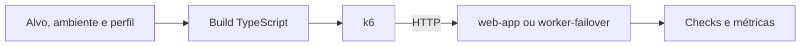

  

# Arquitetura

O build usa esbuild para gerar scripts k6 a partir do TypeScript. Os alvos ficam em `src/targets.json` e as travas em [config.ts](https://github.com/Solierrr/infra-stress/blob/main/src/config.ts).

As pastas `src/smoke/` e `src/stress/` contêm os cenários, o `src/web-app.ts` aquece a origem, descobre os assets e verifica as páginas e o `src/web-worker.ts` verifica a borda, a manutenção e as iscas, enquanto os scripts genéricos usam uma lista local de URLs.

O stress sobe por trinta segundos, mantém pico por um minuto e desce por trinta segundos. Os picos padrão são cinquenta usuários virtuais no local, vinte no QA e dez em produção, com possibilidade de ajuste. Não há banco ou serviço próprio.
