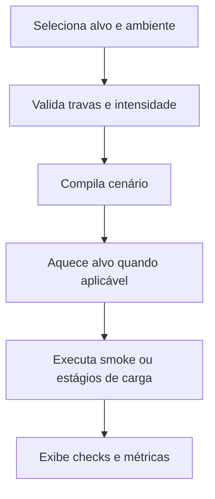

  

# Execução de cenário

O operador seleciona o perfil, prepara o alvo e observa os checks do cenário.

Alvo desconhecido, ambiente sem URL e produção sem confirmação impedem iniciar. O aquecimento pode falhar se a página não responder. A taxa `origin_unavailable` separa respostas de manutenção no cenário da borda.
